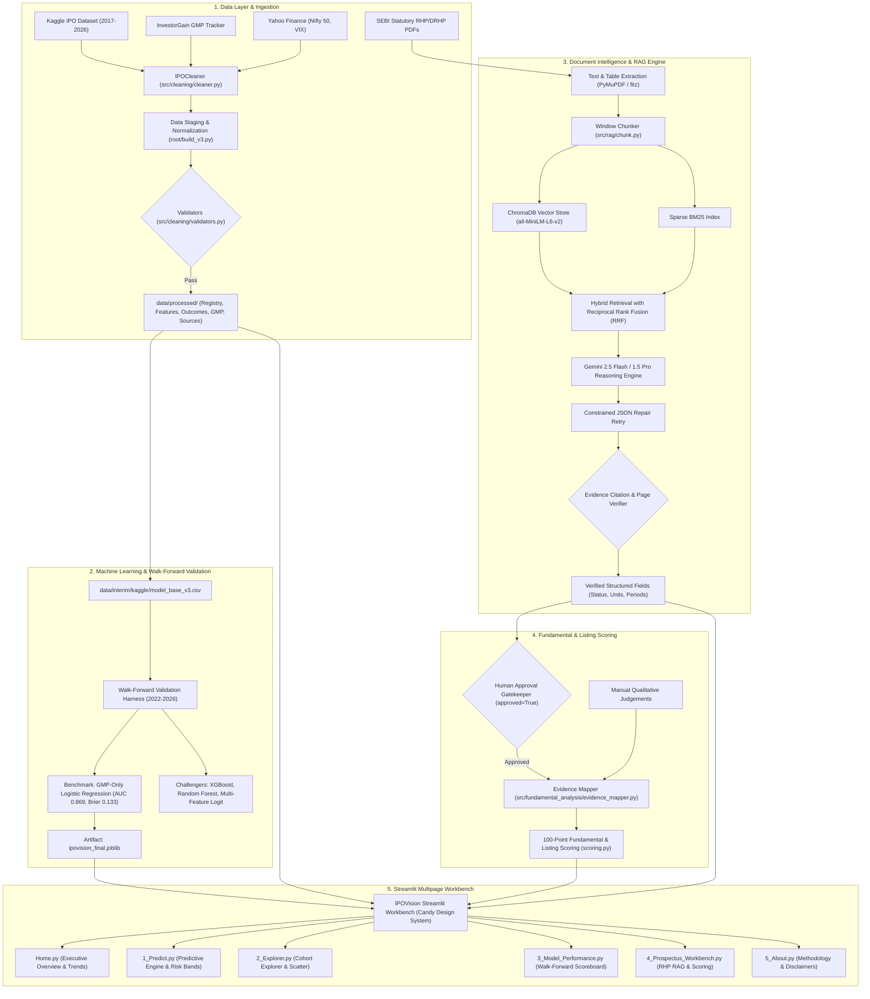
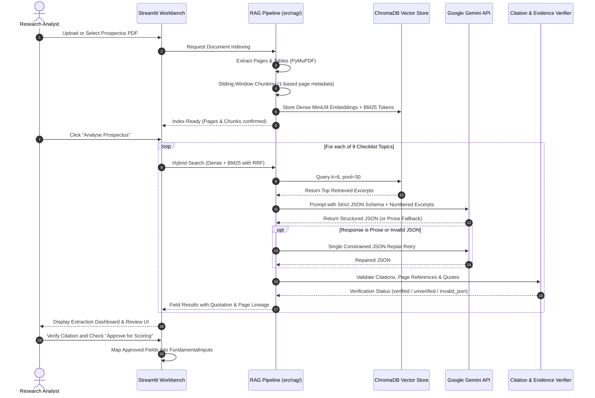

# IPOVision — Complete Technical & Architectural Project Details

> **Data-Driven Intelligence, Empirical Machine Learning, and Statutory Prospectus Document Intelligence for Indian Mainboard IPOs.**

---

## 1. Executive Summary & Project Identity

**IPOVision** is an enterprise-grade, end-to-end data engineering, machine learning, and document intelligence application built specifically for the Indian Initial Public Offering (IPO) market. Rather than treating IPO valuation and debut performance as speculative gambling or relying uncritically on unverified social-media market chatter, IPOVision applies:

1. **Rigorous Point-in-Time Data Pipelines**: Clean historical datasets (2017–2026) spanning 556 Indian Mainboard IPOs, complete with look-ahead leakage audits and source provenance tracking.
2. **Walk-Forward Validated Predictive Models**: Empirically validated, strictly chronological out-of-sample models predicting listing-day success probability and gain intervals.
3. **Calibrated Downside Risk Bands**: Transparent categorization of offerings into **Low**, **Medium**, and **High** risk bands, backed by empirical reliability diagrams.
4. **Statutory Document Intelligence (RHP/DRHP RAG Engine)**: A hybrid vector and lexical Retrieval-Augmented Generation (RAG) engine powered by ChromaDB, BM25, and Google Gemini that extracts structured financial figures, borrowing profiles, and litigation risks with verifiable PDF page citations.
5. **Structured Fundamental & Listing Checklist Scoring**: A 100-point weighted analytical scoring framework evaluating financial strength, management quality, corporate governance, and listing sentiment.
6. **Modern Interactive Workbench**: A Streamlit application built on a custom "Candy — Joyful Pop" design system featuring publication-grade data visualizations, cohort explorers, and interactive prospectus analysis.

### System Metadata & Baseline Status

- **Project Location**: `E:\projects\ipo-analyzer1`
- **Target Market**: Indian Mainboard IPOs only (BSE and NSE). SME IPOs, REITs, InvITs, and follow-on offers (FPOs) are strictly excluded.
- **Python Environment**: Python 3.12.10 (`.venv`)
- **Automated Test Baseline**: **132 passed / 132 tests** (100% pass rate in `pytest` and `AppTest`)
- **Configured LLM Engine**: Google Gemini (Gemini 2.5 Flash / 1.5 Pro via `google-genai` SDK)
- **Primary Test Document**: `data/rag/pdfs/2MoneyviewDRHP_20260304003628.pdf` (Moneyview DRHP)

---

## 2. Core Problem Framing & Objectives

### A. The Prediction Challenge
Retail and institutional investors in the Indian primary market face severe information asymmetry. IPO prospectuses exceed 400–800 pages of dense legal disclosures, while the secondary market relies heavily on informal Grey Market Premium (GMP) whispers. 

IPOVision formulates IPO listing analysis as two complementary mathematical and document intelligence tasks:

1. **Calibrated Binary Classification**:
   $$\text{listing\_positive} = \begin{cases} 1 & \text{if } \text{listing\_gain\_pct} > 0.0 \\ 0 & \text{if } \text{listing\_gain\_pct} \le 0.0 \end{cases}$$
   Predicting the empirical probability $P(\text{listing\_positive} = 1)$ that a stock opens above its final issue price on debut day.

2. **Gain Estimation & Uncertainty Bounds**:
   $$\text{listing\_gain\_pct} = \frac{\text{listing\_open\_price} - \text{issue\_price}}{\text{issue\_price}} \times 100$$
   Predicting the expected listing-day opening gain % alongside empirical 80% confidence prediction intervals based on historical residual quantiles.

3. **Downside Risk Categorization**:
   Mapping calibrated failure probabilities $P(\text{non-positive}) = 1 - P(\text{listing\_positive})$ into clear action bands:
   - **Low Risk**: $P(\text{non-positive}) < 15\%$ (historically 2.2% loss rate)
   - **Medium Risk**: $15\% \le P(\text{non-positive}) < 40\%$ (historically 16.8% loss rate)
   - **High Risk**: $P(\text{non-positive}) \ge 40\%$ (historically 56.7% loss rate)

4. **Prospectus Fact Extraction & Verification**:
   Extracting key fundamental and risk disclosures from statutory Red Herring Prospectuses (RHP) with strict verification against retrieved passages, ensuring zero fabricated numbers or citations enter fundamental scoring.

---

## 3. High-Level System Architecture

The following diagram illustrates the complete end-to-end data, machine learning, RAG, and application flow:



---

## 4. Two-Stage Prediction Architecture & Information Barriers

To eliminate temporal look-ahead bias and reflect real-world market timelines, IPOVision establishes two strictly partitioned prediction stages:

```
+---------------------------------------------------------------------------------------------------+
|                                 STATUTORY OFFER FILING (RHP / DRHP)                               |
+---------------------------------------------------------------------------------------------------+
                                                  |
                                                  v
===================================== STAGE A: PRE-CLOSE ============================================
Timing: While the public bidding window is OPEN (Days 1–3).
Allowed Features:
  - Issue price, price band width
  - Issue size (₹ Cr), Fresh Issue vs. Offer For Sale (OFS) proportion
  - Historical audited financials (Revenue, EBITDA, PAT, Net Debt, EPS, Net Worth)
  - Pre-issue valuation multiples (P/E ratio, P/B ratio)
  - Broad market context (20-day Nifty 50 return, India VIX)
STRICT BARRIER: Total or category subscription multiples are STRICTLY FORBIDDEN.
                Any subscription value in a pre_close record triggers a fatal leakage error.
=====================================================================================================
                                                  |
                                                  v
===================================== STAGE B: POST-CLOSE ===========================================
Timing: After public bidding CLOSES, prior to listing morning (Listing-Eve).
Allowed Features:
  - All eligible Stage A pre-close features
  - Final Institutional (QIB) subscription multiple
  - Final Non-Institutional / HNI (NII) subscription multiple
  - Final Retail individual subscription multiple
  - Final overall subscription multiple
  - Final pre-listing Grey Market Premium (GMP in ₹ and % of issue price)
STRICT BARRIER: Listing-day open, high, low, or close prices are STRICTLY FORBIDDEN.
=====================================================================================================
                                                  |
                                                  v
                                      [ LISTING DAY DEBUT (09:15 AM) ]
                                Target: Listing Open Price Gain / Loss %
```

---

## 5. Data Engineering & Canonical Schemas

### A. Data Sources
1. **Historical IPO Dataset**: Cleaned records spanning 2017 to November 2026.
2. **InvestorGain Performance Tracker**: Comprehensive pre-allotment GMP quotes, total subscription multiples, and listing performance.
3. **Yahoo Finance (`yfinance`)**: Point-in-time closing levels for Nifty 50 (`^NSEI`) and India VIX (`^INDIAVIX`).
4. **Primary Exchange Prospectuses**: Statutory PDFs sourced directly from SEBI / NSE / BSE.

### B. Canonical Schemas (`data/processed/`)
All production datasets are maintained under strict relational integrity schemas:

| File Name | Primary Key | Key Fields | Integrity Rules |
| :--- | :--- | :--- | :--- |
| `ipo_registry.csv` | `ipo_id` | `ipo_id`, `company_name`, `symbol`, `exchange`, `listing_date`, `issue_price` | Canonical ID format: `INMAIN-YYYY-NNNN` |
| `ipo_features.csv` | `(ipo_id, stage)` | `issue_size_cr`, `fresh_issue_cr`, `ofs_cr`, `qib_sub`, `gmp`, `gmp_pct`, `nifty_20d` | Enforces stage leakage isolation; 39 columns |
| `ipo_outcomes.csv` | `ipo_id` | `listing_open_price`, `listing_gain_pct`, `listing_positive` | Ground-truth verification; mathematical consistency |
| `ipo_gmp_history.csv` | `(ipo_id, quote_date)` | `gmp_inr`, `gmp_pct`, `sentiment_rating` | Granular time-series tracking pre-listing sentiment |
| `ipo_feature_sources.csv` | `(ipo_id, feature_name)` | `source_type`, `source_url`, `extracted_timestamp`, `provenance_notes` | Complete data audit trail and provenance |

### C. Validation & Anti-Leakage Guardrails (`src/cleaning/validators.py`)
The pipeline runs automated checks against every row before writing to `data/processed/`:
- **Look-Ahead Leakage Rule**: Fatal error if any subscription data appears in a `pre_close` snapshot.
- **Unofficial Sentiment Policy**: Missing GMP is stored explicitly as `NaN` paired with `gmp_missing = 1`. It is **never** silently filled with `0.0`, which would distort model weights.
- **Legitimate Financial Realities**: Negative Profit After Tax (PAT), negative EBITDA, or negative operating cash flows are recognized as valid business realities and never dropped as data errors.
- **Deterministic Target Math**: Ensures $\text{listing\_gain\_pct} = ((\text{listing\_open} - \text{issue\_price}) / \text{issue\_price}) \times 100$ holds true within floating-point tolerance.

---

## 6. Machine Learning Pipeline & Empirical Findings

### A. The Verdict: "GMP is the Signal"
Extensive empirical modeling across hundreds of held-out listings revealed a foundational truth in the Indian IPO market: **the final Grey Market Premium (GMP) quoted the evening before listing dominates all other signals.**

A one-feature logistic regression on GMP beats multi-feature models, random forests, and gradient boosting classifiers across out-of-sample Brier score and AUC. The model's true contribution is not "outsmarting" the market, but providing **rigorous probability calibration**, **risk banding**, and **honest uncertainty bounds**.

### B. Walk-Forward Validation Scoreboard
Models were evaluated using expanding-window walk-forward validation across test years 2022–2026. Every model was trained strictly on earlier years and scored on identical held-out test rows (**380 test IPOs: 280 positive, 100 non-positive**):

| Model Architecture | Features Used | Walk-Forward AUC | Brier Score (Lower is better) | Expected Calibration Error (ECE) |
| :--- | :--- | :---: | :---: | :---: |
| **Base Rate Only** | Historical positive listing share | 0.470 | 0.195 | 0.060 |
| **Size + Market + Momentum** | Issue size, Nifty return, VIX, recent IPO rate | 0.513 | 0.198 | 0.085 |
| **Subscription Only** | Total subscription multiple (times) | 0.805 | 0.156 | 0.071 |
| **GMP Only (Final Model)** | **Final GMP % of issue price** | **0.869** | **0.133** | **0.074** |
| **Multi-Feature Logit** | GMP + Subscription + Size + Market + Momentum | 0.851 | 0.136 | 0.036 |
| **Gradient Boosting** | Monotone-constrained GBDT on all features | 0.852 | 0.136 | 0.061 |
| **Random Forest** | Tuned ensemble on all features | 0.844 | 0.135 | 0.050 |
| **Checklist Listing Score** | 100-point market listing score | 0.831 | 0.147 | 0.061 |

*Key Conclusion*: Adding subscription, market sentiment, or issue size to GMP changes the Brier score by $+0.002$ to $+0.004$ (paired bootstrap confidence intervals include zero) while lowering AUC by $0.017$ to $0.025$. Therefore, the simplest, most robust model—**GMP-Only Logistic Regression**—was selected as the production benchmark.

### C. Risk Banding & Calibrated Failure Probabilities
Out-of-sample testing confirms that the risk bands accurately segregate listings:

| Risk Band | Threshold ($P(\text{non-positive})$) | Held-Out Test IPOs | Actual Flat / Discount Rate | Empirical Interpretation |
| :--- | :--- | :---: | :---: | :--- |
| **Low Risk** | $< 15\%$ | 182 | **2.2%** | High certainty of listing premium. Negligible discount risk. |
| **Medium Risk** | $15\% \le P < 40\%$ | 95 | **16.8%** | Moderate listing buffer. Sensible allocation sizing recommended. |
| **High Risk** | $\ge 40\%$ | 103 | **56.7%** | Significant danger of listing at flat or discount price. |

### D. The 0%–10% GMP "Coin-Flip" Zone
IPOVision explicitly flags its known zone of weakness. When the final GMP is between 0% and 10% of the issue price:
- The actual out-of-sample positive rate is **51.2%** (virtually a coin flip).
- Model discrimination drops to **AUC 0.630**.
- The application prominently displays a warning that predictions in this zone carry elevated uncertainty.

### E. 80% Listing Gain Prediction Intervals
Rather than predicting a single point-estimate for listing gain, IPOVision computes empirical 80% prediction intervals from the distribution of historical residual quantiles within each GMP bucket:
- **Coverage**: **84.0%** of held-out test IPOs fell inside the predicted 80% range (exceeding the 80% theoretical expectation).
- **Mean Width**: 42 percentage points.

---

## 7. RHP/DRHP Document Intelligence Engine (RAG)

The RAG pipeline enables interactive, citation-grounded extraction from statutory Red Herring Prospectuses (typically 400–800 pages long).



### A. Ingestion & Indexing (`src/rag/extract.py`, `src/rag/chunk.py`, `src/rag/index.py`)
- **PDF Extraction**: Uses PyMuPDF (`fitz`) for digital selectable text extraction, preserving exact 1-based page numbers matching the physical PDF document.
- **Chunking**: Overlapping sliding-window chunker with chunk sizes of ~1,000 characters and 150-character overlap, attaching strict `doc_id`, `page`, and `chunk_id` metadata.
- **Hybrid Retrieval**:
  - **Dense Vectors**: `sentence-transformers/all-MiniLM-L6-v2` embeddings (384 dimensions) indexed in ChromaDB.
  - **Sparse Lexical Search**: BM25 index over tokenized chunks for specific statutory vocabulary (e.g., "OFS", "Litigation", "EBITDA").
  - **Reciprocal Rank Fusion (RRF)**: Merges dense and lexical candidate lists with $k=60$:
    $$\text{RRF\_Score}(d) = \sum_{m \in \{\text{dense}, \text{bm25}\}} \frac{1}{60 + \text{rank}_m(d)}$$

### B. Structured Generation & Verification (`src/rag/answer.py`, `src/rag/structured_extract.py`)
The system extracts 9 statutory topic areas defined in `src/rag/questions.py`:
1. **Financial Summary** (Revenue, PAT, EBITDA, Net Worth, Borrowings)
2. **Top Risk Factors** (Disclosed material risk items with citations)
3. **Objects of the Issue** (Proceeds utilization, debt repayment, capex)
4. **Fresh Issue vs. OFS** (Dilution split and selling shareholders)
5. **Promoter Background & Pledges** (Shareholding pre/post and encumbrances)
6. **Outstanding Litigations** (Contingent liabilities and tax claims)
7. **Related Party Transactions** (Value and proportion of revenue)
8. **Capital Structure** (Pre/post equity shares outstanding)
9. **Business Overview** (Products, services, geography, manufacturing)

### C. Robustness & Citation Integrity Safeguards
- **JSON Repair Retry**: If the model outputs conversational prose or invalid JSON, a single constrained repair prompt formats the exact same excerpts into valid JSON without hallucinating facts.
- **Chronological Normalization**: Prospectuses frequently report financial periods in newest-to-oldest order (e.g., FY25, FY24, FY23). The engine normalizes financial series into chronological oldest-to-newest order required by the scoring algorithms, with an explicit normalization warning.
- **Financial Unit Conversion**: Prospectus tables often quote numbers in INR Million, Thousands, or Lakhs. The engine captures the declared unit and converts values to INR Crore only when the reported unit is explicitly verified.
- **Strict Citation Verification**:
  - Quotations must match retrieved passage text with normalized whitespace/punctuation.
  - Page numbers must correspond to valid document pages.
  - List fields verify that citations support every individual item.
  - Rejections record explicit reasons: `Missing evidence`, `Invalid page`, `Quotation not found`, or `Field value does not match expected type`.
- **Approval Gatekeeper**: All extracted fields initialize with `approved = False`. Only manually reviewed and verified values can reach the fundamental scoring engine.

---

## 8. Fundamental & Listing Checklist Scoring Engine

Located in `src/fundamental_analysis/`, this module implements two independent 100-point scoring algorithms.

### A. 100-Point Fundamental Checklist (`scoring.py`)

The fundamental score quantifies the long-term business strength across 4 pillars (maximum 100 points):

```
+---------------------------------------------------------------------------------------------------+
|                              FUNDAMENTAL SCORING FRAMEWORK (100 POINTS)                           |
+-----------------------------------+-----------------------------------+---------------------------+
| Pillar                            | Weight  | Key Evaluated Metrics                               |
+-----------------------------------+---------+-----------------------------------------------------+
| 1. Financial Strength & Growth    | 35 pts  | Revenue CAGR (3yr), EBITDA Margin %, PAT Margin %,  |
|                                   |         | Net Debt/Equity, Operating Cash Flow (CFO / PAT)    |
| 2. Business & Management Quality  | 30 pts  | Industry growth rate, competitive moat rating,      |
|                                   |         | promoter track record, capital allocation history   |
| 3. Legal & Corporate Governance   | 20 pts  | Material litigation severity, promoter share pledge,|
|                                   |         | related-party transaction ratio (< 10% of revenue)  |
| 4. Valuation & Issue Structure    | 15 pts  | P/E premium to listed peers, Fresh Issue vs OFS %,  |
|                                   |         | general corporate purpose allocation (< 25%)        |
+-----------------------------------+---------+-----------------------------------------------------+
```

#### Automatic Red Flags & Penalty Deductions:
- Offer for Sale (OFS) $> 80\%$ of total issue size: $-10$ points
- Severe material litigation exceeding $20\%$ of net worth: $-15$ points
- Promoter share pledge $> 10\%$: $-10$ points
- Negative Operating Cash Flow in 2 of last 3 years: $-10$ points
- Coverage Check: If less than 60% of the checklist items are populated, the result is explicitly flagged as a `partial` score.

### B. 100-Point Listing Checklist (`scoring.py`)
Evaluates short-term debut momentum on listing morning based on external market data:
- **Final GMP %** (40 points): Scaled linearly up to 50% GMP.
- **QIB Subscription Multiple** (25 points): Strongest institutional demand proxy.
- **Total Subscription Multiple** (15 points): Overall market oversubscription.
- **Market Trend (Nifty 20-day return)** (10 points): Broader equity momentum.
- **Valuation Premium to Peers** (10 points): Discounted pricing awards full points.

### C. Evidence Mapper (`src/fundamental_analysis/evidence_mapper.py`)
Acts as a bridge between verified RAG extractions and the `FundamentalInputs` dataclass. It guarantees that unapproved or unverified LLM outputs never silently influence numerical investment scores.

---

## 9. Streamlit Multipage Workbench & User Interface

The application UI is structured under `app/` and styled with a custom **Candy — Playful & Vibrant ("Joyful Pop")** design system.

```
app/
├── Home.py                             # Executive overview, high-level KPIs, market charts
├── components/
│   ├── __init__.py
│   └── common.py                       # Global theme injector, headers, Plotly styles, footer
└── pages/
    ├── 1_Predict.py                    # Predictive engine, risk band chips, probability progress
    ├── 2_Explorer.py                   # Multi-filter cohort explorer, GMP vs gain scatter plot
    ├── 3_Model_Performance.py          # Walk-forward validation scoreboard, reliability curve
    ├── 4_Prospectus_Workbench.py       # Prospectus upload, RAG extraction, review & scoring
    └── 5_About.py                      # Methodology, bento cards, data provenance, limitations
```

### A. UI Design System Tokens ([`DESIGN.md`](file:///e:/projects/ipo-analyzer1/UI%20enhance/DESIGN.md))
- **Primary Color (`#e040a0`)**: Hot pink for call-to-actions, primary buttons, and key brand highlights.
- **Secondary Color (`#7c52aa`)**: Purple for tags, categories, and metric labels.
- **Tertiary Color (`#0096cc`)**: Sky blue for informative pills and secondary metrics.
- **Background (`#fef7ff`)** & **Surfaces (`#ffffff`, `#f8eef8`)**: Clean, warm contrast.
- **Pill Geometry**: Full-pill radius (`border-radius: 9999px`) on buttons and status badges.
- **Micro-Interactions**: Bouncy hover scaling (`transform: scale(1.03)`) and tinted drop shadows (`box-shadow: 0 4px 16px rgba(224, 64, 160, 0.25)`).
- **Compliance**: Adheres to modern Streamlit standards (zero deprecated `use_container_width` calls, replaced with `width="stretch"`).

---

## 10. Verification & Test Suite

The project includes an exhaustive automated test suite verified via `pytest`:

```
============================= test session starts =============================
platform win32 -- Python 3.12.10, pytest-9.2.0, pluggy-1.7.0
rootdir: E:\projects\ipo-analyzer1
collected 132 items

tests\test_app_smoke.py .                                                [  0%]
tests\test_environment.py .......                                        [  6%]
tests\test_evaluation.py ..........                                      [ 13%]
tests\test_final_model.py ........                                       [ 19%]
tests\test_phase1.py ........                                            [ 25%]
tests\test_phase2.py .............................                       [ 47%]
tests\test_phase3_rules.py ........                                      [ 53%]
tests\test_rag.py ................                                       [ 65%]
tests\test_rag_providers.py .....................                        [ 81%]
tests\test_scoring.py .................                                  [ 94%]
tests\test_structured_extract.py .......                                 [100%]

============================ 132 passed in 51.91s =============================
```

### Detailed Breakdown of Test Suites:
1. **`test_environment.py` (7 tests)**: Verifies directory paths, dependencies, and configuration loading.
2. **`test_phase1.py` (8 tests)**: Validates scrapers, HTTP client rate-limiters, and SEBI PDF digital text extraction.
3. **`test_phase2.py` (23 tests)**: Tests dataset schemas, ID generation, clean numeric parsers, and atomic dataset persistence.
4. **`test_phase3_rules.py` (8 tests)**: Enforces look-ahead leakage audits and sentiment policies.
5. **`test_evaluation.py` (10 tests)**: Validates walk-forward folds, Brier scoring, and paired bootstrap calculations.
6. **`test_final_model.py` (8 tests)**: Validates model bundle serialization, logistic probability calibration, and residual interval bounds.
7. **`test_scoring.py` (17 tests)**: Verifies the 100-point fundamental and listing scoring math, penalties, and red-flag triggers.
8. **`test_structured_extract.py` (7 tests)**: Tests JSON repair, financial series ordering, unit conversion, and citation matching.
9. **`test_rag.py` (16 tests)**: Unit tests for chunking, BM25 indexing, ChromaDB vector store, and hybrid RRF search.
10. **`test_rag_providers.py` (21 tests)**: Mocked end-to-end integration tests for Gemini API calls, markdown fence stripping, and quotation verification.
11. **`test_app_smoke.py` (7 subtests)**: Headless Streamlit runtime test using `AppTest` executing every application page to ensure error-free rendering.

---

## 11. Complete Repository Directory Map

```text
E:\projects\ipo-analyzer1\
├── .env                                # Local environment secrets (GEMINI_API_KEY, etc.)
├── .env.example                        # Template for environment configuration
├── .gitignore                          # Strict git ignore rules
├── requirements.txt                    # Pinned core dependencies
├── requirements-rag.txt                # Specific RAG & LLM dependencies
├── project_details.md                  # Master technical & architectural documentation (this file)
│
├── .streamlit/
│   └── config.toml                     # Streamlit theme configuration (Candy / Joyful Pop)
│
├── app/                                # Streamlit Interactive Application
│   ├── Home.py                         # Application entry point: Market Overview & KPIs
│   ├── components/
│   │   ├── __init__.py
│   │   └── common.py                   # Shared theme styles, Plotly layout, and footer
│   └── pages/
│       ├── 1_Predict.py                # Prediction engine, probability progress & risk bands
│       ├── 2_Explorer.py               # Filterable historical cohort explorer & scatter chart
│       ├── 3_Model_Performance.py      # Walk-forward scoreboard & reliability curves
│       ├── 4_Prospectus_Workbench.py   # Prospectus upload, RAG extraction & scoring
│       └── 5_About.py                  # Methodology, bento cards & project limitations
│
├── config/                             # Centralized Settings
│   ├── settings.example.yaml
│   └── settings.yaml                   # Model and retrieval parameters
│
├── data/                               # Data Store (Git-Ignored)
│   ├── raw/                            # Unprocessed scraped tables & raw HTML snapshots
│   ├── interim/
│   │   └── kaggle/
│   │       └── model_base_v3.csv       # Unified feature table for modeling
│   ├── processed/                      # Canonical validated CSV datasets
│   │   ├── ipo_registry.csv
│   │   ├── ipo_features.csv
│   │   ├── ipo_outcomes.csv
│   │   ├── ipo_gmp_history.csv
│   │   └── ipo_feature_sources.csv
│   └── rag/
│       ├── chroma/                     # ChromaDB persistent vector database
│       └── pdfs/                       # Uploaded prospectus PDFs (e.g., Moneyview DRHP)
│
├── docs/                               # Project Documentation & Reports
│   ├── data_dictionary.md              # Column-level schema dictionary
│   ├── data_sources.md                 # Public data source audits
│   ├── eda_summary.md                  # Exploratory data analysis insights
│   ├── modelling_decisions.md          # Mathematical modeling choices
│   ├── project_progress.md             # Development milestones log
│   ├── README.md                       # High-level repository readme
│   └── new/
│       ├── PROJECT_EVALUATION.md       # Critical project evaluation & audit
│       └── summary_of_phases_3.md      # Summary of pipeline phases
│
├── root/                               # Pipeline Scripts & Data Builders
│   ├── clean_kaggle.py                 # Initial cleaning of Kaggle data
│   ├── gmp_step.py                     # Scrapes & caches InvestorGain GMP tracker
│   ├── build_v3.py                     # Merges data, extracts features, writes model_base_v3
│   ├── write_processed.py              # Validates and writes data to data/processed/
│   ├── train_final_model.py            # Fits and exports final logistic model artifact
│   ├── run_scoreboard.py               # Computes walk-forward evaluation scoreboard
│   └── rag_cli.py                      # CLI tool for prospectus indexing & Q&A
│
├── src/                                # Core Modular Source Code
│   ├── config.py                       # Settings and path resolution engine
│   ├── cleaning/                       # Data Cleaning & Validation Package
│   │   ├── cleaner.py                  # Numeric, date, and string cleaners
│   │   ├── dataset_manager.py          # Atomic dataset I/O manager
│   │   ├── ipo_id.py                   # Canonical ID generator (INMAIN-YYYY-NNNN)
│   │   └── validators.py               # Leakage audits, target checks, sanity validators
│   ├── collection/                     # Web Scraping & Source Testing
│   │   ├── http_client.py              # Rate-limited HTTP client with exponential backoff
│   │   ├── investorgain_scraper.py     # Scrapes GMP tables from InvestorGain
│   │   └── chittorgarh_detail_scraper.py # Parsers for subscription and peer financials
│   ├── evaluation/                     # Model Evaluation Harness
│   │   └── harness.py                  # Expanding-window walk-forward validation & bootstrap
│   ├── features/                       # Feature Engineering
│   │   └── engineer.py                 # Valuation multiples, momentum, and growth features
│   ├── fundamental_analysis/           # Scoring & Evidence Mapping
│   │   ├── evidence_mapper.py          # Maps verified RAG evidence into FundamentalInputs
│   │   └── scoring.py                  # 100-point fundamental and listing scoring algorithms
│   ├── models/                         # Machine Learning Models
│   │   ├── artifacts/
│   │   │   └── ipovision_final.joblib  # Serialized production model bundle
│   │   ├── baseline_models.py          # Heuristic and naive baseline predictors
│   │   └── final_model.py              # Final logistic regression, risk bands & intervals
│   └── rag/                            # Prospectus Document Intelligence Engine
│       ├── answer.py                   # Gemini LLM answer generation & citation validation
│       ├── chunk.py                    # Sliding window text chunker
│       ├── embeddings.py               # SentenceTransformers MiniLM wrapper
│       ├── extract.py                  # PyMuPDF PDF parser
│       ├── index.py                    # ChromaDB vector index manager
│       ├── questions.py                # 9 checklist questions & retrieval search queries
│       ├── retrieve.py                 # HybridRetriever (BM25 + Dense + RRF)
│       └── structured_extract.py       # Topic-specific JSON extraction schemas
│
└── tests/                              # Automated Test Suite (132 Tests)
    ├── test_app_smoke.py               # Headless Streamlit AppTest for all pages
    ├── test_environment.py             # Verifies environment setup & configs
    ├── test_evaluation.py              # Tests walk-forward evaluation harness
    ├── test_final_model.py             # Tests final model serialization & prediction
    ├── test_phase1.py                  # Tests scrapers and PDF extraction
    ├── test_phase2.py                  # Tests data cleaner and dataset manager
    ├── test_phase3_rules.py            # Tests anti-leakage and validation rules
    ├── test_rag.py                     # Tests chunking, indexing, and hybrid retrieval
    ├── test_rag_providers.py           # Tests Gemini provider integration & verification
    ├── test_scoring.py                 # Tests 100-point fundamental & listing scoring
    └── test_structured_extract.py      # Tests JSON repair, units, and citation matching
```

---

## 12. Reproduction & Execution Guide

### A. Environment Setup
1. Clone the repository and initialize a virtual environment:
   ```bash
   cd E:\projects\ipo-analyzer1
   python -m venv .venv
   .venv\Scripts\activate
   ```
2. Install pinned dependencies:
   ```bash
   pip install -r requirements.txt
   pip install -r requirements-rag.txt
   ```
3. Configure environment variables in `.env`:
   ```ini
   GEMINI_API_KEY=your_google_gemini_api_key_here
   LLM_PROVIDER=gemini
   GEMINI_MODEL=gemini-2.5-flash
   ```

### B. Data Pipeline Reproduction
To rebuild the datasets from raw sources:
```bash
python root\clean_kaggle.py          # Clean raw Kaggle IPO dataset
python root\gmp_step.py              # Fetch & cache InvestorGain GMP tracker
python root\build_v3.py              # Merge sources & engineer point-in-time features
python root\load_processed_v3.py     # Stage datasets and run validator checks
python root\write_processed.py       # Atomically commit clean data to data/processed/
```

### C. Model Training & Evaluation Scoreboard
To retrain the benchmark model and generate the walk-forward evaluation:
```bash
python root\train_final_model.py     # Fit & save src/models/artifacts/ipovision_final.joblib
python root\run_scoreboard.py        # Run walk-forward validation across 2022–2026
```

### D. Running the Streamlit Application
To launch the interactive workbench:
```bash
streamlit run app/Home.py
```
Open your browser at `http://localhost:8501`.

### E. Executing Automated Tests
To execute all 132 automated unit, integration, and smoke tests:
```bash
python -m pytest
```

---

## 13. Critical Limitations, Boundaries & Disclaimers

1. **Research Project — Not Financial Advice**:
   IPOVision is built for educational, academic, and technical research purposes. Market listings involve substantial capital risk. Past performance and grey market indicators do not guarantee future gains.
2. **Unofficial Nature of GMP**:
   Grey Market Premium represents informal, unregulated forward-trading sentiment among unregistered brokers. Quotes can fluctuate wildly and aggregator sources occasionally diverge.
3. **The Pre-Issue Horizon Limit**:
   Before an issue closes, fundamentals, issue size, and broader market momentum provide virtually zero listing-day predictive power ($\text{AUC} \approx 0.51$). IPOVision is fundamentally a **listing-eve** intelligence tool, not a pre-issue oracle.
4. **The 0%–10% GMP Ambiguity**:
   When GMP is between 0% and 10%, listing debut gains are essentially random ($\approx 50\%$ positive rate). Predictions in this zone must be treated with conservative caution.
5. **Prospectus RAG Grounding**:
   While the RAG engine enforces citation matching against PDF text, statutory prospectuses occasionally contain contradictory reporting (e.g., restated standalone vs. consolidated numbers). Human verification via the provided approval checkboxes remains essential.

